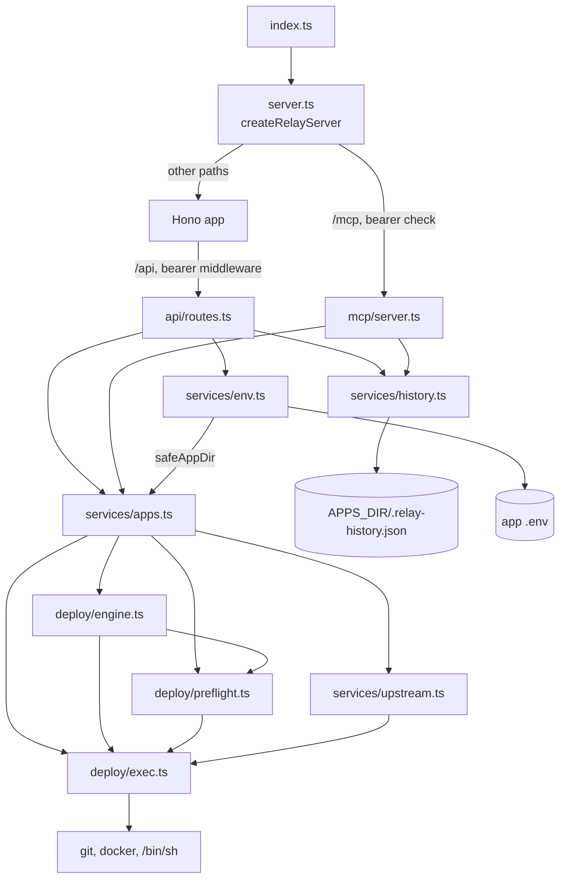

# Contributing to agent-relay

Thanks for your interest. agent-relay is a VPS deployment relay for AI agents, run via Docker.

## Issues

- Bug reports: include repro steps, expected vs. actual, the relay command path (HTTP API or MCP), and Docker / Node version where relevant.
- Feature requests: describe the use case before the proposed shape.

## Pull Requests

1. Fork, branch off `main` (e.g. `feat/<scope>`, `fix/<scope>`).
2. Keep changes scoped where possible.
3. Run the local checks:

   ```bash
   npm install
   npm run build
   npm run lint
   npm test
   ```

   When `install.sh` changes, also run `docker run --rm -v "$PWD:/mnt" -w /mnt koalaman/shellcheck:v0.10.0 install.sh` and `npx bats@1.11.1 test/`, as CI does.

4. For deployment-path changes, dogfood against a real VPS target (or against the example compose file `docker-compose.prod.example.yml`) before submitting.
5. Open the PR with a clear summary, motivation, and test plan.

## Dev Setup

```bash
git clone https://github.com/LanNguyenSi/agent-relay.git
cd agent-relay
npm install
npm run build
npm test
```

For the deployed flavor: see `Dockerfile` and `docker-compose.prod.example.yml`.

## Architecture

The module map below shows how a request travels from the entry point to the subprocesses the relay runs and the files it writes. Paths are relative to `src/`.

- HTTP entry and auth: `index.ts` binds the port; `server.ts` sends `/mcp` to the MCP transport after a bearer check and everything else to the Hono app, which serves the public `GET /health` and mounts `api/routes.ts` behind bearer middleware.
- MCP: `mcp/server.ts` defines the 5 tools on top of the same services.
- Services: `services/apps.ts` (app lookup, deploy, rollback, logs, status), `services/env.ts` (per-app `.env`), `services/history.ts` (deploy history), `services/upstream.ts` (remote head lookup).
- Deploy: `deploy/engine.ts` (the deploy flow), `deploy/preflight.ts` (pre-flight checks), `deploy/exec.ts` (runs `git`, `docker` and `/bin/sh` as subprocesses).
- Config: `config/env.ts` (process environment), `config/relay.ts` (`.relay.yml` schema and loading).



## Style

Match the surrounding code. Prefer small, reviewable diffs.
