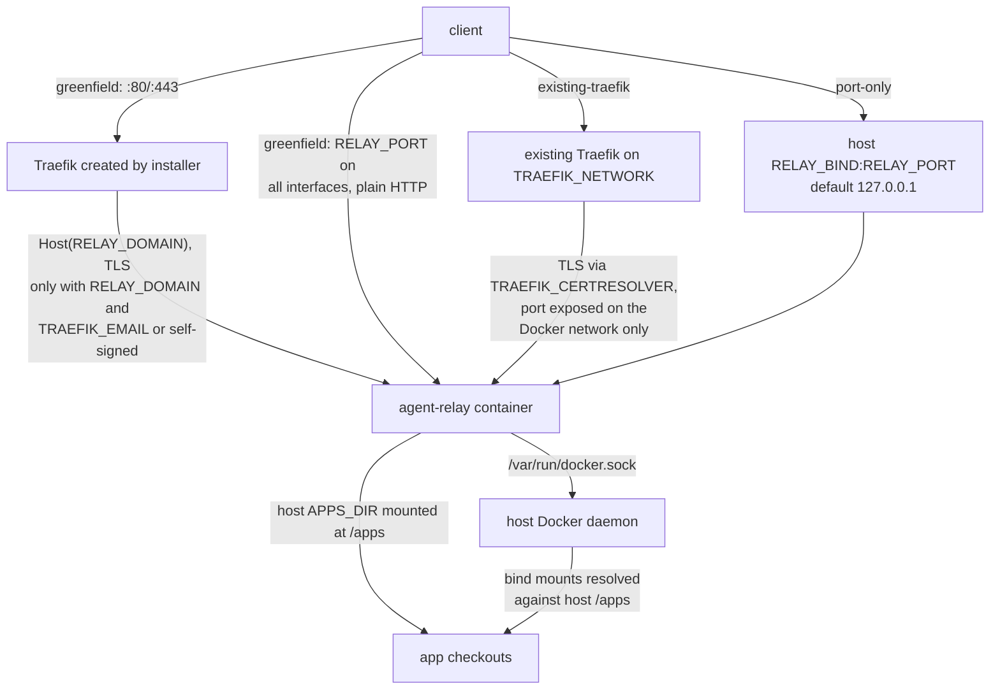
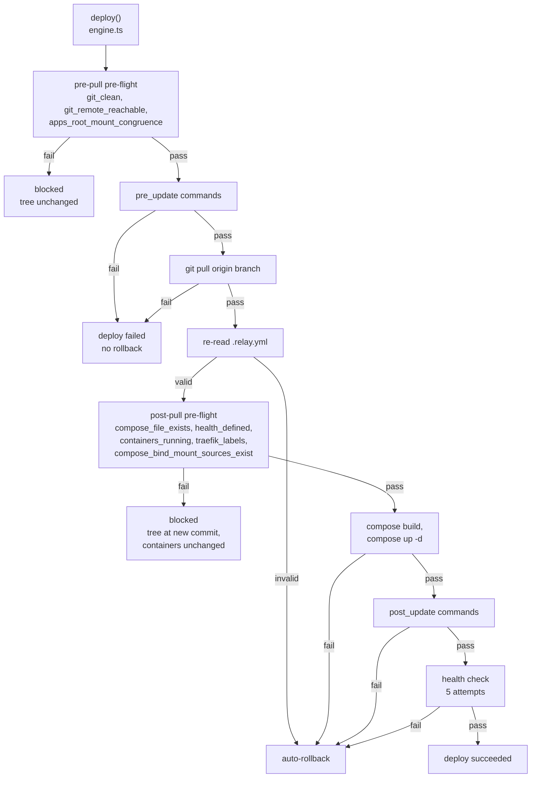
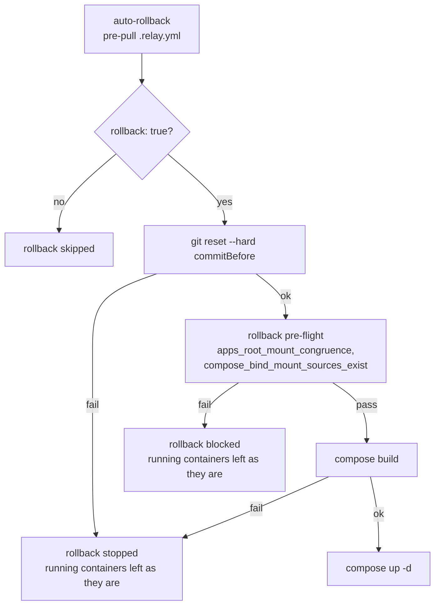

# Operations

Installing the relay on a VPS, running it locally for development, the runtime env vars it cares about, and the [Deploy lifecycle](#deploy-lifecycle) it runs on every deploy.

## VPS installer

One-command install on Ubuntu/Debian:

```bash
curl -sSL https://raw.githubusercontent.com/LanNguyenSi/agent-relay/main/install.sh | sudo bash
```

Without env vars on a host where :80 is free, this selects `greenfield` without a domain, which serves the relay as plain HTTP on port 8222 on all interfaces. See [Install modes](#install-modes).

The installer pulls the published Docker image from `ghcr.io/lannguyensi/agent-relay:latest`, built and pushed by `.github/workflows/publish.yml` on every `v*` tag and on every merge to `main` that changes more than documentation (a push whose changed files all match `docs/**`, root-level `*.md` or `LICENSE` does not publish). The image must be **public** for the unauthenticated pull to work; after the first workflow run on a fresh repository, a maintainer must flip the package visibility once at [github.com/users/LanNguyenSi/packages/container/agent-relay/settings](https://github.com/users/LanNguyenSi/packages/container/agent-relay/settings) (GitHub defaults new packages to Private). If you see `denied` from the pull step, that is almost always the cause.

The published image is built for `linux/amd64` only, so on an arm64 host the pull fails. There, build the image from source with `docker-compose.prod.example.yml` (it uses `build: .`) instead of the installer.

The installer:

1. Installs Docker if missing; fails if the Compose v2 plugin is not available.
2. Detects what owns :80 and resolves the install mode (see below).
3. In `greenfield` mode: creates the `traefik-public` network and starts Traefik if it is not running.
4. Creates `RELAY_DIR` and `APPS_DIR` and enforces the host `/apps` symlink (see [APPS_DIR host/container contract](#apps_dir-hostcontainer-contract)).
5. Reuses the auth token from an existing `$RELAY_DIR/.env` or generates one, and writes `.env`.
6. Writes the mode-specific compose file, pulls the image and starts the relay.
7. Waits up to 15 s for `/health` inside the container and fails the install if it does not answer.
8. Prints connection info (mode, URL, token) and, when UFW is active, the missing allow rules.

The compose file generated by `install.sh` mounts no SSH credentials. For apps with private SSH git remotes, add a read-only mount such as `- /root/.ssh:/root/.ssh:ro` (or a dedicated deploy-key directory that also holds `known_hosts`) under `volumes:` in `$RELAY_DIR/docker-compose.yml`, then run `docker compose up -d` there. Re-running `install.sh` rewrites that compose file, so re-apply the mount after a reinstall. Otherwise use HTTPS remotes with credentials stored in each checkout. Without credentials, the `git_remote_reachable` pre-flight check fails and blocks the deploy unless `force` is set, and with `force` the deploy fails at `git pull`.

## Install modes

`RELAY_MODE` (default `auto`) selects how the relay exposes itself:

| Mode | What it does | When to use |
|------|--------------|-------------|
| `greenfield` | Creates `traefik-public` network + a Traefik container with Let's Encrypt; relays routes to `RELAY_DOMAIN`. Also publishes `RELAY_PORT` on all host interfaces as plain HTTP. | Fresh VPS, nothing on :80/:443 |
| `existing-traefik` | Skips Traefik creation; joins the relay to `TRAEFIK_NETWORK` with labels routing `RELAY_DOMAIN` via `TRAEFIK_CERTRESOLVER` | VPS already has a Traefik you want to route through |
| `port-only` | No Traefik, no TLS; relay binds `RELAY_BIND:RELAY_PORT` directly on the host | Non-Traefik reverse proxy (nginx/Caddy) handles TLS, or you only need loopback access |
| `auto` (default) | Detects :80. Free → `greenfield`. Owned by a Traefik container → `existing-traefik`. Owned by anything else + `RELAY_DOMAIN` unset → `port-only`. Owned by anything else + `RELAY_DOMAIN` set → **refuse** with actionable guidance | Let the installer pick |

The diagram shows what each mode exposes, and why host `/apps` must be the apps directory. In every mode the relay container mounts the Docker socket and the host `APPS_DIR` at `/apps`.



## Installer environment variables

Set these before running the script to customise the install:

| Variable | Default | Description |
|----------|---------|-------------|
| `RELAY_MODE` | `auto` | `auto` / `greenfield` / `existing-traefik` / `port-only` |
| `RELAY_DOMAIN` | -- | FQDN the relay should serve. Required for `existing-traefik`. In `greenfield` it is needed for the TLS route but not enforced: without it, the relay is served only as plain HTTP on `RELAY_PORT`. |
| `TRAEFIK_EMAIL` | -- | Email for Let's Encrypt. Required in `greenfield` when `RELAY_DOMAIN` is set. Not required when `TRAEFIK_CA=self-signed`. |
| `TRAEFIK_NETWORK` | `traefik-public` | Docker network of the existing Traefik (used in `existing-traefik` mode) |
| `TRAEFIK_CERTRESOLVER` | `letsencrypt` | ACME resolver name configured on the existing Traefik |
| `TRAEFIK_CA` | `letsencrypt` | TLS provider for greenfield Traefik. Values: `letsencrypt` (default, production LE), `staging` (LE staging CA, untrusted cert), `pebble` (custom Pebble CA at `PEBBLE_URL`), `self-signed` (Traefik built-in cert, no ACME). Only affects `greenfield` mode. |
| `PEBBLE_URL` | -- | Pebble CA server URL (e.g. `https://pebble:14000/dir`). Required when `TRAEFIK_CA=pebble` |
| `RELAY_BIND` | `127.0.0.1` | Host bind IP for `port-only` mode. Use `0.0.0.0` to expose publicly |
| `APPS_DIR` | `/home/deploy/apps` (root) or `$HOME/.local/share/agent-relay/apps` (non-root) | Host directory containing app directories |
| `RELAY_DIR` | `/opt/agent-relay` (root) or `$HOME/.local/share/agent-relay` (non-root) | Directory for relay config and compose file |
| `RELAY_PORT` | `8222` | Port for the relay HTTP server |
| `SKIP_TRAEFIK` | -- | `1` = back-compat alias for `RELAY_MODE=port-only` (only applied when `RELAY_MODE` is left at `auto`) |
| `RELAY_FORCE_RECREATE` | -- | `1` = remove an existing `agent-relay` container before starting the new one (use when a container left by a failed install blocks the port) |

### APPS_DIR host/container contract

The relay container mounts the host's `APPS_DIR` at `/apps`, and the relay itself runs `docker compose` *inside* that container (Docker-outside-of-Docker, DooD) via the mounted `/var/run/docker.sock`. The docker **daemon** always resolves compose bind-mount sources against the **host** filesystem: it has no notion of the relay container's own view of `/apps`. The relay's `.env` always pins `APPS_DIR=/apps` (its in-container view), independent of whatever host directory the installer's `APPS_DIR` pointed at. So when the relay asks the daemon to bring up a deployed app whose compose file bind-mounts a path under `/apps`, the daemon must find that same content at the literal host path `/apps`.

The contract this implies: the host directory `/apps` must be **the same directory** as the true apps dir. In practice that means either:

- `APPS_DIR` on the host **is** `/apps`, or
- `/apps` on the host is a **symlink** to the real `APPS_DIR` (for example `/apps -> /root/git`).

`install.sh` enforces this automatically on every run: if `APPS_DIR != /apps`, it creates the symlink when `/apps` does not exist yet (this needs root), confirms an existing symlink already resolves to the right target, or fails loudly with the exact fix command if `/apps` exists as anything else (a real directory, a plain file, or a symlink to somewhere else). It never silently overwrites an existing `/apps`.

Two preflight checks in `src/deploy/preflight.ts` guard this contract on every deploy:

- **`apps_root_mount_congruence`** (pre-pull, critical): round-trips a marker token through a throwaway `docker run` that bind-mounts `APPS_DIR`. If the relay is containerized and the daemon cannot see the marker (or sees something else), the host and the relay disagree about `/apps`, and the check fails closed with a fix hint pointing at the host symlink. It passes trivially when the relay is not containerized at all (no DooD, so no daemon-vs-container view gap is possible).
- **`compose_bind_mount_sources_exist`** (post-pull, critical): parses the freshly pulled app's compose file and checks that every bind-mount source path under `APPS_DIR` actually exists from the relay's own filesystem view. Named volumes and unresolved `${VAR}` or outside-`APPS_DIR` absolute paths are skipped, not checked.

**Why this matters (2026-07-15 incident):** when the host and the relay disagreed about `/apps`, `docker compose` did not error, it silently auto-created every missing file bind-mount source as an **empty directory** on the host, while the deploy still reported success. A deployed app's real config file was shadowed by an empty directory of the same name. If either preflight check above fails, start by running `docker inspect <relay-container>` on the docker host to find the real apps directory, then create the symlink by hand: `sudo ln -s <real apps dir> /apps`.

### Examples

> **Note:** shell env-var prefixes bind to the command they precede. In `VAR=x curl ... | sudo bash`, `VAR` is set for `curl`, not for the `bash` that runs the downloaded script -- and `sudo` resets the environment by default. Download the script first, then pass env vars on the `sudo` line. If your sudoers strips command-line variables, export them and use `sudo -E`, or run as root directly.

Greenfield (fresh VPS):

```bash
curl -sSL https://raw.githubusercontent.com/LanNguyenSi/agent-relay/main/install.sh -o /tmp/agent-relay-install.sh
sudo RELAY_DOMAIN=relay.example.com \
     TRAEFIK_EMAIL=you@example.com \
     APPS_DIR=/home/deploy/apps \
     bash /tmp/agent-relay-install.sh
```

Existing Traefik on a different network:

```bash
curl -sSL https://raw.githubusercontent.com/LanNguyenSi/agent-relay/main/install.sh -o /tmp/agent-relay-install.sh
sudo RELAY_MODE=existing-traefik \
     RELAY_DOMAIN=relay.example.com \
     TRAEFIK_NETWORK=proxy \
     TRAEFIK_CERTRESOLVER=myresolver \
     bash /tmp/agent-relay-install.sh
```

Port-only (nginx handles TLS, relay on loopback):

```bash
curl -sSL https://raw.githubusercontent.com/LanNguyenSi/agent-relay/main/install.sh -o /tmp/agent-relay-install.sh
sudo RELAY_MODE=port-only bash /tmp/agent-relay-install.sh
```

### Non-root install

The installer can run without `sudo` if your user is in the `docker` group. It detects this automatically via `docker info` and enters non-root mode.

Requirements:

- **docker group**: `sudo usermod -aG docker $USER` then log out/in so `docker info` succeeds without `sudo`.
- **HOME-writable paths**: all files except the `/apps` symlink go to HOME-relative directories. Defaults and overrides:
  - `RELAY_DIR` defaults to `$HOME/.local/share/agent-relay` (override with `RELAY_DIR=...`). `/opt/agent-relay` is never created in non-root mode.
  - `APPS_DIR` defaults to `$HOME/.local/share/agent-relay/apps` (override with `APPS_DIR=...`). `/home/deploy/apps` is never created in non-root mode.
- **Host `/apps` symlink (needs root once)**: the installer requires host `/apps` to be the apps directory (see [APPS_DIR host/container contract](#apps_dir-hostcontainer-contract)) and stops with `Could not create symlink /apps -> ...` when it cannot create it. Before running the installer, create it once as root: `sudo ln -s "$HOME/.local/share/agent-relay/apps" /apps` (or point it at your `APPS_DIR`).
- **Existing reverse proxy**: `RELAY_MODE=greenfield` is rejected in non-root mode with a clear error because Traefik bootstrap writes to `/opt/traefik` and binds :80/:443. Use `existing-traefik` (join an existing Traefik) or `port-only` instead.

Example (join an existing Traefik):

```bash
curl -sSL https://raw.githubusercontent.com/LanNguyenSi/agent-relay/main/install.sh \
  | RELAY_MODE=existing-traefik RELAY_DOMAIN=relay.example.com bash
```

Example (port-only, no TLS):

```bash
curl -sSL https://raw.githubusercontent.com/LanNguyenSi/agent-relay/main/install.sh \
  | RELAY_MODE=port-only RELAY_BIND=0.0.0.0 bash
```

(Env vars go to the right of the pipe so they reach the `bash` running the script.)

## Running locally

### Development

```bash
git clone https://github.com/LanNguyenSi/agent-relay.git
cd agent-relay
npm install
mkdir -p apps
export AUTH_TOKEN=change-me APPS_DIR="$PWD/apps"
npm run dev            # starts on port 8222 with hot reload (tsx watch)
```

`npm run dev` (and `make dev`) loads a `.env` file from the working directory when one exists (`tsx watch --env-file-if-exists=.env`) and otherwise uses the shell environment alone; values already set in the shell take precedence over the file. Without `AUTH_TOKEN` the process exits at startup. `APPS_DIR` defaults to `/apps`, which usually does not exist on a development machine, so point it at a local directory (`.env.example` sets the container path `/apps`; use `APPS_DIR=./apps` for `npm run dev`); the relay lists no apps when that directory does not exist.

### Docker

```bash
# Set AUTH_TOKEN in environment or .env file
docker compose up --build
```

If `AUTH_TOKEN` is set neither in the shell nor in `.env`, this compose file falls back to the token `dev-token` while publishing port 8222 on all interfaces with the Docker socket mounted. On a machine reachable from a network, set a real token or change the port mapping to `127.0.0.1:8222:8222`.

The `docker-compose.yml` mounts `/var/run/docker.sock` (for container management), the apps directory, and `/root/.ssh` read-only (so `git pull` can authenticate to private remotes over SSH). Override the SSH source path with `SSH_DIR` in the dev `docker-compose.yml`; the production `docker-compose.prod.example.yml` mounts it the same way. If your apps only use public or HTTPS git remotes, the SSH mount is harmless but unused. The compose file that `install.sh` generates has no SSH mount; see [VPS installer](#vps-installer).

### Zombie processes (defunct `[git]` entries)

The relay runs `git`, `docker` and `/bin/sh` steps as child processes. Git itself detaches its own housekeeping after commands such as commit, push, fetch and pull (`git maintenance run --auto --detach`, formerly `gc --auto`): that background process outlives the git the relay spawned and is reparented to the container's PID 1 when it exits. A step killed by its timeout, or one that leaves a grandchild behind (a git transport helper, a backgrounded command), produces the same kind of orphan. Node as PID 1 only reaps children it spawned itself, so those orphans stay defunct (`Z` in `ps`) until the container restarts. This was seen on a long-running relay as dozens of defunct `[git]` entries.

The image therefore runs `tini` as its entrypoint (`ENTRYPOINT ["/sbin/tini", "-s", "--"]`), and the compose files set `init: true` (the two shipped compose files and every variant `install.sh` generates). `-s` makes tini a subreaper, so the two layers stack safely.

Shutdown behaviour changed with the init: `docker stop` and container recreation now deliver SIGTERM to node directly, and the relay ends immediately (exit 143) with no graceful drain. Before the change node ran as PID 1 without a SIGTERM handler, so the signal was ignored and Docker escalated to SIGKILL after about 10 s.

Applying the fix to an existing install depends on how it was created:

- Compose file built from source (`build: .`, the repository's `docker-compose.yml` and `docker-compose.prod.example.yml`): `docker compose up -d --build`.
- Install created by `install.sh` (the generated compose uses `image: ghcr.io/lannguyensi/agent-relay:latest` and has no `build:`): once the image is republished, run `docker compose pull && docker compose up -d`. Compose files generated before this change also lack `init: true`; the tini entrypoint in the image covers that case.

Check a running relay (expect `tini` as PID 1 and no `Z` rows):

```bash
docker exec agent-relay ps -o pid,ppid,stat,comm
```

For the repository's dev `docker-compose.yml` (no `container_name`), run `docker compose exec relay ps -o pid,ppid,stat,comm` from the repository root.

### Scripts

| Script | Command | Description |
|--------|---------|-------------|
| `dev` | `tsx watch --env-file-if-exists=.env src/index.ts` | Dev server with hot reload |
| `build` | `tsc` | Compile TypeScript |
| `start` | `node dist/index.js` | Run production build |
| `lint` | `eslint src/` | Lint source code |
| `typecheck` | `tsc --noEmit` | Type check without emitting |
| `test` | `vitest run` | Run tests |
| `test:watch` | `vitest` | Run tests in watch mode |
| `coverage` | `vitest run --coverage` | Run tests with coverage report |

## Runtime environment variables

| Variable | Required | Default | Description |
|----------|----------|---------|-------------|
| `AUTH_TOKEN` | Yes | -- | Bearer token for API and MCP authentication |
| `PORT` | No | `8222` | HTTP server port |
| `APPS_DIR` | No | `/apps` | Directory containing app directories, as seen by the relay process. The installer bind-mounts the host `APPS_DIR` (see [Installer environment variables](#installer-environment-variables)) onto `/apps` and writes `APPS_DIR=/apps` into the relay's `.env`, so this rarely needs overriding |
| `RELAY_REVISION` | No | `"unknown"` | Build commit SHA reported as `revision` on `GET /health` and `GET /api/health`. Baked into the published GHCR image at build time (`ARG RELAY_REVISION=""` / `ENV RELAY_REVISION=$RELAY_REVISION` in `Dockerfile`, set from `github.sha` by `.github/workflows/publish.yml`); local or development runs without `RELAY_REVISION` (or with an empty/whitespace value) report `revision: "unknown"` |

## Runtime state and troubleshooting

- **Deploy history**: `.relay-history.json` in `APPS_DIR` (on an installer host, the host `APPS_DIR`), newest 100 entries across all apps. The relay reads the file once and keeps it in memory, so edit it by hand only while the relay is stopped. A file that cannot be parsed is treated as empty and overwritten by the next deploy record, so back it up before editing it.
- **Self-update state**: `.relay-self-update.json` in `APPS_DIR`, written by `POST /api/self-update` (`status`: `in_progress`, `succeeded`, `unverified`, `failed`, or `refused`). When the recreated relay starts up (or serves `GET /api/self-update`), it reconciles an `in_progress` record: `succeeded` once `RELAY_REVISION` matches `targetRevision`; `failed` with the helper container's exit code and log tail when the helper exited non-zero, or when it exited 0 but the relay still runs the old revision (compose recreated nothing); `unverified` when the helper exited 0 and the target image carries no revision label; `failed` after 10 minutes without a helper outcome (a helper that is still running keeps the record `in_progress` until it exits). The helper container is kept after it exits (label `agent-relay.self-update-helper=true`) so its outcome stays inspectable; finished helpers are removed at the start of the next self-update, running ones are left alone.
- **Concurrency**: deploys (`deploy`) and rollbacks (`rollbackApp`) run side by side as before; a relay self-update (`prepareSelfUpdate`) holds the in-memory operation lock (`src/deploy/engine.ts`) exclusively. A self-update requested while any deploy or rollback runs, and a deploy or rollback requested while a self-update runs, return `409 Conflict`. The relay does not serialize deploys or rollbacks of the same app: do not start two deploys, or a deploy and a rollback, for the same app at once.
- **Upgrading an installer install**: either trigger `POST /api/self-update` (authenticated with `Bearer <AUTH_TOKEN>`, or via `deploy-panel`'s one-click `Update relay` button), which inspects the relay container's `com.docker.compose.*` labels, reads the compose file on the host through the Docker daemon (a short-lived `--network none` container of the relay's own image with the compose directory bind-mounted read-only, so the directory does not need to be mounted into the relay), refuses when the relay was started with an env file other than `<working_dir>/.env` (the helper could not reproduce those variables), refuses unless the compose file's `image:` is exactly the requested `ghcr.io/lannguyensi/agent-relay:<tag>` (the installer pins `:latest`, so request the default tag), pulls `ghcr.io/lannguyensi/agent-relay:<tag>`, returns `202 Accepted`, and spawns a detached helper container (`--entrypoint docker`, `/var/run/docker.sock` and the compose working directory mounted `:ro`) to run `docker compose -p <project> -f <file> up -d <service>`; or run `docker compose pull && docker compose up -d` in `RELAY_DIR` over SSH. If a self-update fails or the new container does not become healthy, recover via `deploy-panel`'s SSH `Update Relay Image` flow (`POST /api/servers/:id/update-relay-image`) or `docker compose pull && docker compose up -d` on the host.
- **Rotating the token**: edit `AUTH_TOKEN` in `$RELAY_DIR/.env`, then run `docker compose up -d --force-recreate` in `RELAY_DIR`. Re-running `install.sh` keeps the existing token.

## Deploy lifecycle

Each app on the VPS is a git repo with a `docker-compose.yml` and a `.relay.yml`. The default flow:

1. **Deploy.** pre-flight checks (pre-pull) -> `pre_update` commands -> `git pull` -> re-read `.relay.yml` -> pre-flight checks (post-pull) -> `docker compose build` -> `docker compose up -d` -> `post_update` commands.
2. **Health check.** In-container probe: for each running compose service, `docker compose exec` runs a `node -e` fetch against `http://localhost:<port><health>` -- the port comes from `health_port`, or a fixed candidate list (3000, 3001, 4000, 5000, 8000, 8080). Up to 5 attempts, 5 seconds apart; the first service/port that responds OK passes. At least one running service image must therefore include Node.js 18 or later (global `fetch`); an app without Node.js in any service fails every health check. On final failure, the step's `output` carries the last probe's HTTP status (or fetch error) and a capped tail of `docker compose logs` from the running service(s) -- operators should be aware that runtime app-container log content lands in the deploy record's step output, not just a pass/fail summary. No redaction is applied to that log tail.
3. **Auto-rollback.** When the re-read `.relay.yml` is invalid, or `compose build`, `compose up`, a `post_update` command or the health check fails, the relay runs `git reset --hard` to the previous commit. It then reruns the two `APPS_DIR` checks (`apps_root_mount_congruence`, `compose_bind_mount_sources_exist`) and rebuilds and restarts only if both pass. The `rollback` value from the pre-pull `.relay.yml` decides whether this runs at all. A failed `pre_update` or `git pull` does not roll back, and neither does a deploy blocked by the post-pull pre-flight. In the blocked case the checkout stays at the new commit while the containers keep running the old image.

`.relay.yml` is re-read **after** `git pull` on purpose: a commit that *fixes* a broken `.relay.yml` lets the deploy through, instead of pre-flight gating on the stale pre-pull copy. Full rationale in [docs/security.md](security.md#why-relayyml-is-re-read-after-git-pull).

The first diagram traces the default deploy path through `deploy()` in `src/deploy/engine.ts` and shows every exit: blocked by pre-flight, failed without rollback, auto-rollback, or success. A `.relay.yml` with `command` takes a separate path (pre-flight, the command, re-read `.relay.yml`, health check, auto-rollback) that it does not show.



The second diagram shows the auto-rollback itself, which runs with the pre-pull `.relay.yml` and is gated by the two `APPS_DIR` checks.


